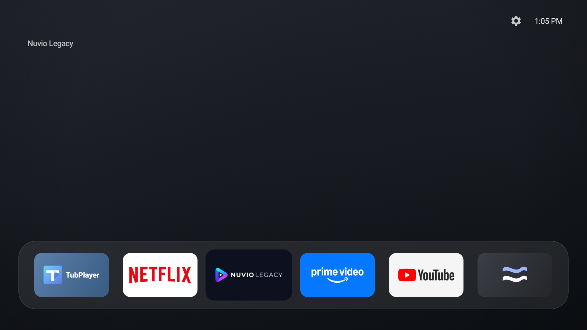
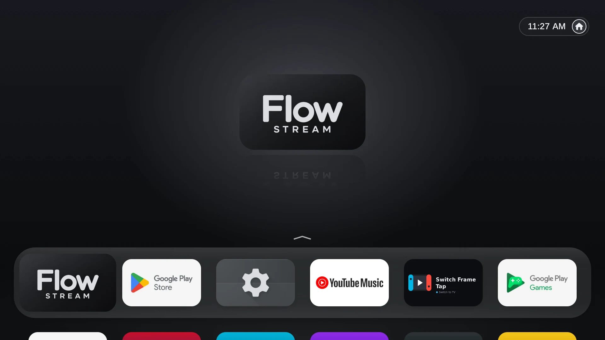
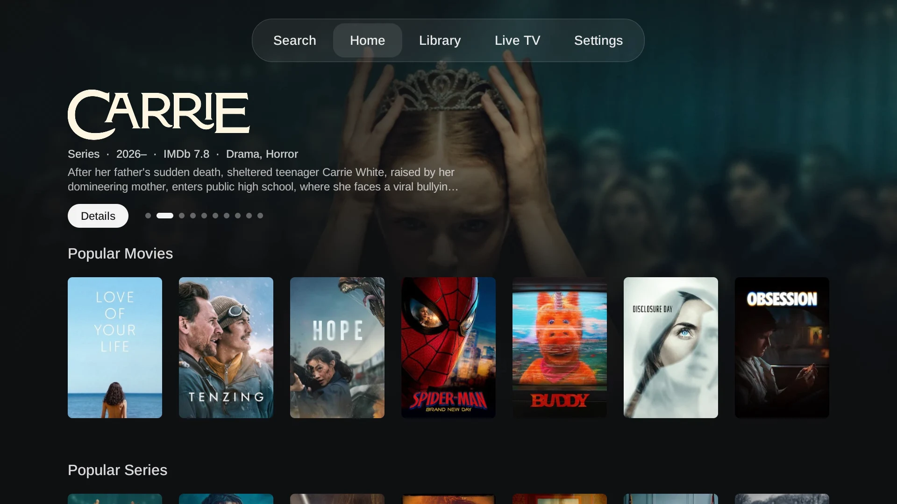

# Flow Launcher

**An Apple TV-style home screen for Android TV and Google TV.** Fluid spring animations, a glass dock, and an app switcher, all in a tiny native APK with zero dependencies.

[](https://github.com/sghmire/flow-launcher-tv/releases/tag/v0.6)



## Source Code & Collaboration

Flow is closed source. Signed APKs are published on [GitHub Releases](https://github.com/sghmire/flow-launcher-tv/releases).

Want to collaborate? Android developers and designers are welcome, and access to the private source repository is available on request. Open a [GitHub Issue](https://github.com/sghmire/flow-launcher-tv/issues) or email **[contact@glideformstudio.com](mailto:contact@glideformstudio.com)**.

## Visual Demos

### Open an app

The focused tile grows to fill the screen and lands right in the app.



### Close an app

Press Home and the app shrinks back into its tile. The app keeps running.



### Switch apps with Recents

Double-press Home to fan out your recent apps, browse them, and jump straight back in.


## Installation

Requires **Android TV or Google TV on Android 9 or newer**.

1. Download `flow-v0.6.apk` from the [latest release](https://github.com/sghmire/flow-launcher-tv/releases/tag/v0.6).
2. Copy it to your TV (USB drive or an app like **Send Files to TV**), open it in a file manager, allow **Install unknown apps** if asked, and choose **Install**.
3. Open **Flow**, then pick it as your Home app in the TV's settings so the Home button takes you there.

Prefer ADB?

```sh
adb connect TV_IP:PORT
adb install -r flow-v0.6.apk
adb shell cmd package set-home-activity com.gfs.flow/.HomeActivity
```

## Controls

| Button | Action |
| --- | --- |
| **D-pad** | Move between apps and Top Shelf cards |
| **OK** | Open the focused app, card, or folder |
| **Hold OK** | App options: move, folders, change icon, app info |
| **Back** | Close menus and folders; return to the dock |
| **Home** | Return to Flow |
| **Double Home** | Open Recents (where the TV allows it) |
| **Up in Recents** | Dismiss an app |
| **Menu** | Flow settings |
