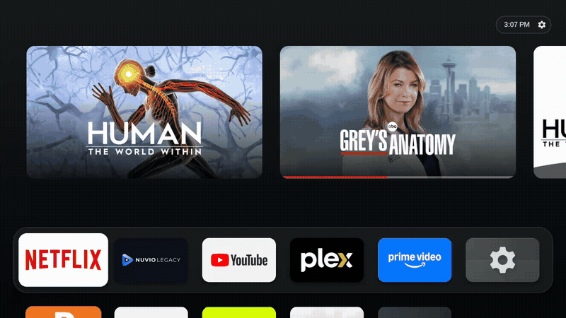
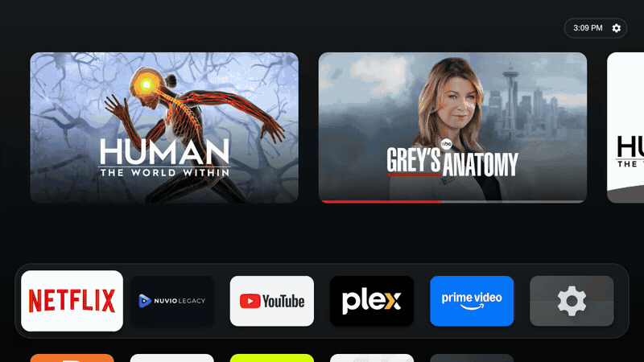
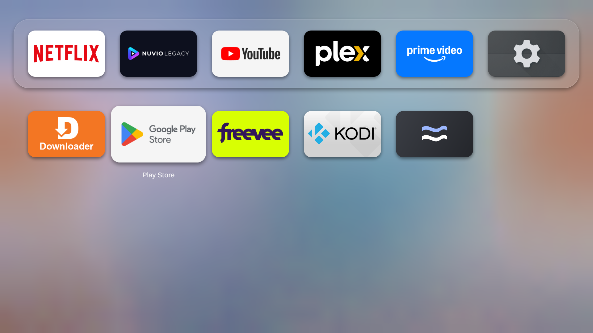
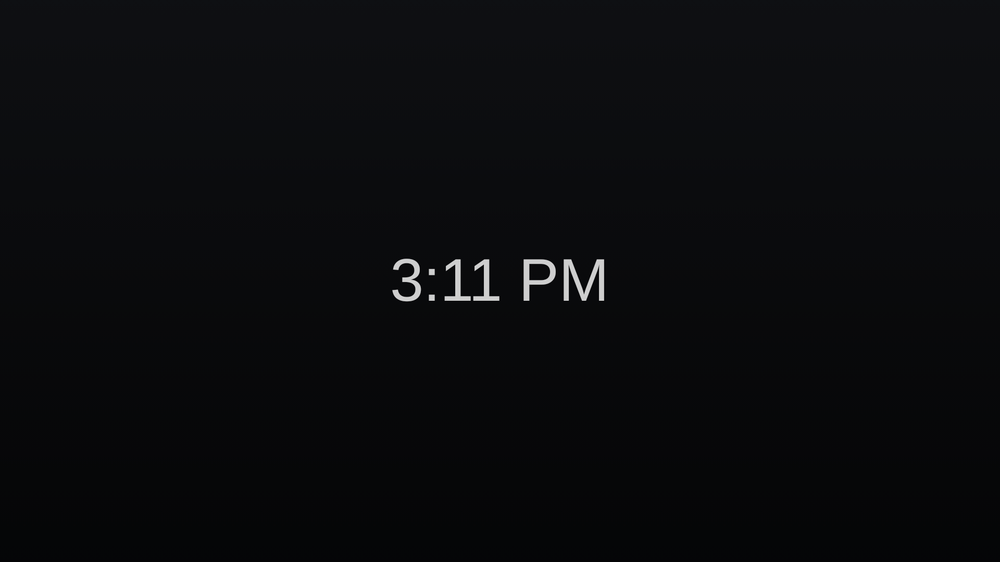

# Flow Launcher

A fast, minimal, Apple TV-inspired launcher for Android TV and Google TV built with 100% native views, fluid spring physics, and zero runtime dependencies.

[](https://github.com/sghmire/flow-launcher-tv/releases/tag/v0.5)
[](https://github.com/sghmire/flow-launcher-tv/releases/tag/v0.5)


> [!NOTE]
> ### Source Code & Collaboration
> Flow Launcher is maintained as a closed-source project. Pre-built, signed APKs are distributed directly via [GitHub Releases](https://github.com/sghmire/flow-launcher-tv/releases).
>
> **Interested in collaborating?**  
> If you are an Android developer or designer wanting to contribute or collaborate on Flow, access to the private source code repository is happily provided upon request! Please reach out by opening a [GitHub Issue](https://github.com/sghmire/flow-launcher-tv/issues) or emailing **[contact@glideformstudio.com](mailto:contact@glideformstudio.com)**.

---

## Highlights

- **tvOS-Inspired Layout**: Top Shelf recommendations above a six-column grid of 5:3 app tiles, featuring a frosted glass dock and smooth backdrop blur.
- **Fluid Spring Physics**: Real-time critically damped springs power focus scaling, dock glide, and deep-row grid scrolling.
- **Hero App Transitions**: Expanding tile launch animations and collapsing home-button return transitions.
- **4-Way App Reordering**: Move tiles freely in all four directions—between dock and grid rows—with real-time drop shadow tracking and elevation.
- **Per-App Customization**: Choose between official brand logos, original banners, icon + text, dark mode icons, or custom imagery.
- **Hidden App Vault**: Organize rarely used or private apps in a dedicated hidden folder tile at the end of the grid.
- **App Switcher (Recents)**: Apple TV-style fullscreen task switcher with swipe-up to dismiss.
- **Flow Clock Screensaver**: Burn-in safe, drift-compensated OLED clock in Helvetica typography.
- **Pure Native Performance**: Zero third-party runtime libraries, small size, and high-framerate remote navigation.

---

## Visual Demos

### Fluid Navigation & tvOS AppGrid

Moving down out of the glass dock smoothly slides the entire 6-column grid upward on spring physics while the Top Shelf blurs and frosts.



### Opening an App (Hero Transition)

Expanding app-opening transition from the focused dock tile directly into the app's splash and landing screen.


### App-to-Home Return Animation

Pressing Home from inside an app collapses the viewport smoothly back down into the dock tile without force-stopping the running application.


### 4-Way App Reordering

Hold OK or press Menu to lift any tile. Directional keys slide the tile across both dock and grid rows with real-time shadow tracking and elevation.



### Personalization & App Switcher

| App Context Menu | Tile Styles Customization |
| --- | --- |
|  |  |

| tvOS AppGrid (6 Columns) | Fullscreen Recents Switcher |
| --- | --- |
|  |  |

### Flow Clock Screensaver

A minimal, dim clock centered on pure black that follows the device's 12/24-hour preference and exits instantly on remote input.



---

## Installation

Requires **Android TV / Google TV running Android 9.0 (API 28) or newer**.  
Package ID: `com.gfs.flow`

### 📥 Download Release APK
- **Latest Release**: [Flow Launcher v0.5 (GitHub Releases)](https://github.com/sghmire/flow-launcher-tv/releases/tag/v0.5)
- **Direct Download**: [flow-v0.5.apk](https://github.com/sghmire/flow-launcher-tv/releases/download/v0.5/flow-v0.5.apk)

### Method 1: Sideload via USB or File Manager
1. Download the latest `flow-v0.5.apk` from the [v0.5 Release](https://github.com/sghmire/flow-launcher-tv/releases/tag/v0.5) page.
2. Transfer the APK to your TV using a USB flash drive or an app like **Send Files to TV**.
3. Open the APK with any TV file manager. If prompted, grant permission to **Install unknown apps**, then choose **Install**.
4. Open **Flow** from your apps list.

### Method 2: Sideload via ADB
If your TV has Network or USB Debugging enabled:

```sh
adb connect TV_IP:PORT
adb install -r flow-v0.5.apk
adb shell am start -n com.gfs.flow/.HomeActivity
```

### Optional Setup

On first launch Flow asks for the TV listings and Usage access permissions itself. The commands below are for when you skipped a prompt or your TV has no Usage access screen.

**Set Flow as your default launcher:**
```sh
adb shell cmd package set-home-activity com.gfs.flow/.HomeActivity
```

**Enable Watch Next & TV Listings:**
```sh
adb shell pm grant com.gfs.flow android.permission.READ_TV_LISTINGS
```

**Enable system-wide Usage Access for Recents:**
```sh
adb shell appops set com.gfs.flow GET_USAGE_STATS allow
```

---

## Remote Controls Reference

| Button | Action |
| --- | --- |
| **Left / Right / Up / Down** | Navigate tiles in the dock/grid or browse Top Shelf cards |
| **Up from Top Row** | Focus the first Top Shelf recommendation card |
| **Down from Top Shelf** | Return to the corresponding dock app |
| **OK / Enter** | Open the focused app, card, folder, or action |
| **Hold OK, or Menu** | Open tile options (Move, Change icon, Hide, App info) |
| **D-pad in Move Mode** | Slide tile Up, Down, Left, or Right to reorder |
| **OK / Back in Move Mode** | Save / cancel tile reorder |
| **Back** | Dismiss menus/folders; return from grid to dock |
| **Back on Home** | Start the screensaver when nothing else is open |
| **Home** | Return to Flow home; resets to the first app |
| **Double Home** | Open the Recents app switcher (where supported by TV firmware) |
| **Up in Recents** | Dismiss the selected app card |

---

## Feedback & Collaboration

- **Bug Reports & Feature Requests**: Please open an issue in the [GitHub Issues](https://github.com/sghmire/flow-launcher-tv/issues) tracker.
- **Source Code Access**: If you are interested in collaborating or inspecting the codebase, reach out to **[contact@glideformstudio.com](mailto:contact@glideformstudio.com)**.

---

## Artwork & Acknowledgments

App banners and recommendation artwork are published by installed applications and their Android TV content providers. Supported logo vector assets are adapted from [Simple Icons](https://simpleicons.org/).
