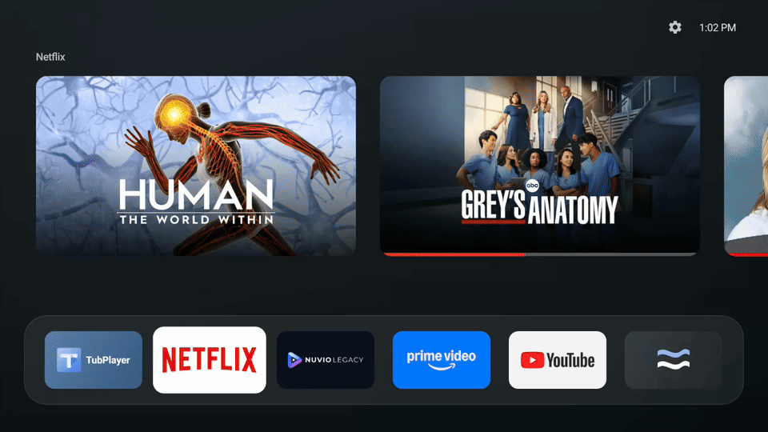
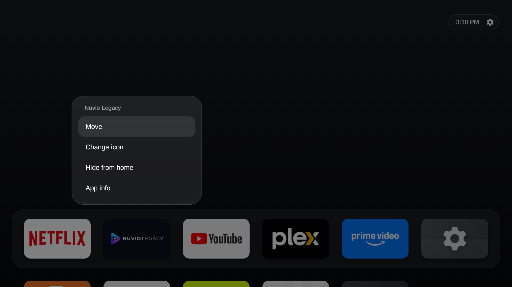
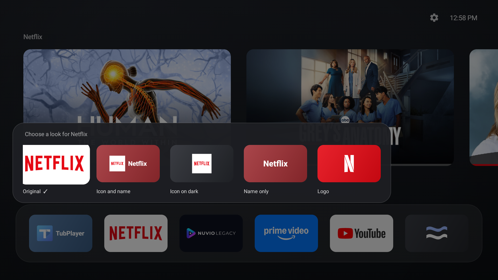
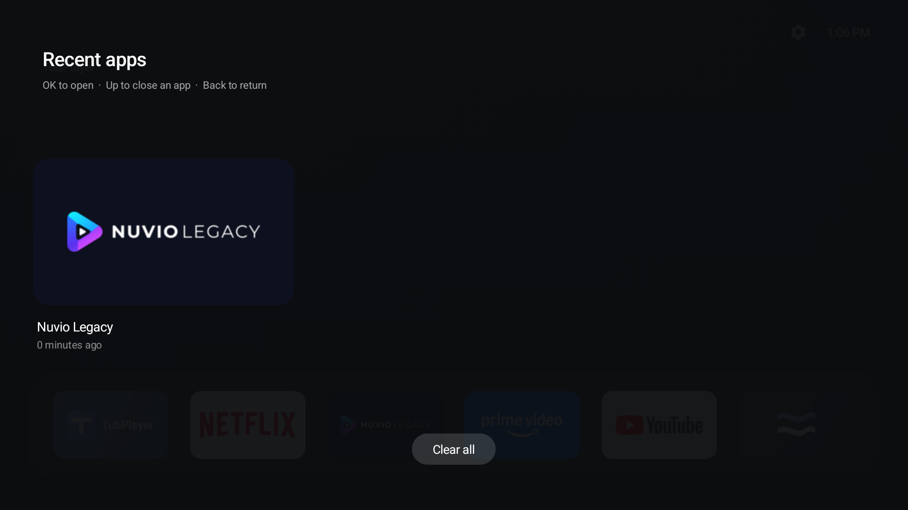
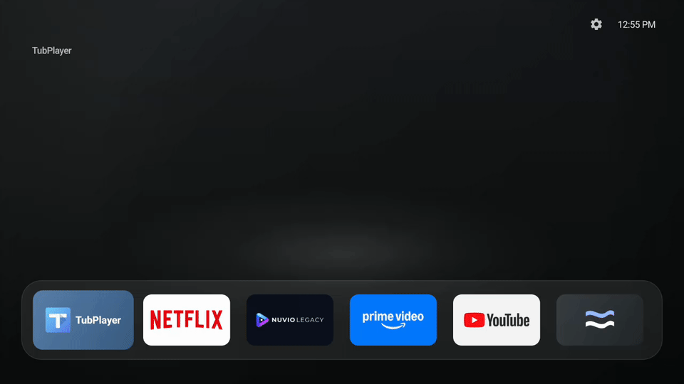

# Flow Launcher

A compact Android TV home screen built with native Java views: a smooth blue-charcoal backdrop, a scrolling app dock, contextual recommendations, and animated app transitions.


[View the background without content cards](docs/images/background.png)

## Features

- Remote-first navigation with animated focus and a six-tile dock viewport.
- Contextual content from Android TV channels and Watch Next, where installed apps publish it.
- Expanding app-opening and collapsing return animations.
- Reorder apps, hide them in a folder, and restore them to the home screen.
- Per-app tile styles: original banner, icon and name, icon on dark, name only, and supported brand logos. Custom pictures appear when configured.
- Recent apps with reopen, dismiss, and Clear all actions.
- Clock, Android settings shortcut, and a minimal Flow Clock screensaver.
- Native Android implementation with no third-party runtime libraries.

### Opening an app

Recorded on an onn. 4K Streaming Box. The demo follows Nuvio Legacy from its dock tile through its splash screen to its loaded home screen.



[View the loaded Nuvio screen](docs/images/app-landing.png)

### Personalization and recent apps

| App menu | Tile styles |
| --- | --- |
|  |  |



### Recent apps and closing animations

Open Recents with double Home, then press Up to dismiss the selected Nuvio app. The capture shows the Nuvio card moving upward and the empty state.



Press Home from an app to return to the dock with a collapsing tile animation. Returning home does not force-stop the app.


## Install

Requires **Android TV / Google TV running Android 9 or newer**. Package ID: `com.gfs.flow`.

1. Download the shared Flow release APK and transfer it to your TV.
2. Open the APK with a file manager. If prompted, allow that file manager to **install unknown apps**, then choose **Install**.
3. Open **Flow** from your apps list.
4. To use Flow when you press Home, choose it in your TV's default Home app settings or Home chooser, if supported.

For updates, install the newer APK over the existing version to keep your layout and preferences. If you previously installed a development build signed with a different key, you must uninstall it first; this removes Flow's saved settings.

Home-button support varies by TV. You can switch back through the default Home settings; there is no need to disable the stock launcher.

<details>
<summary>Optional setup: content rows, recent-app history, and ADB</summary>

Allow TV-listing access if Flow requests it. For recent-app history, enable **Usage access** for Flow in the TV settings where available. Content rows depend on what installed apps publish and may be empty.

If you prefer installing from a computer, enable ADB debugging on the TV and authorize your computer. Use the address and port shown by the TV; wireless pairing, when required, uses a separate pairing port.

```sh
# Only if the TV requires wireless pairing:
adb pair TV_IP:PAIRING_PORT

adb connect TV_IP:DEBUG_PORT
export ANDROID_SERIAL=TV_IP:DEBUG_PORT
adb install -r /path/to/flow.apk
adb shell am start -n com.gfs.flow/.HomeActivity
```

USB connections can use their device serial instead. Optional permissions for content rows and recent-app history:

```sh
adb shell pm grant com.gfs.flow android.permission.READ_TV_LISTINGS
adb shell appops set com.gfs.flow GET_USAGE_STATS allow
```

On TVs supporting this command, set Flow as the default Home app:

```sh
adb shell cmd package set-home-activity com.gfs.flow/.HomeActivity
```

</details>

## Clock screensaver

Open Flow's **gear → Screensaver — Flow Clock**, then select **Flow Clock** in the TV's screensaver settings. Set the idle delay and use the system preview/start option where available. Android controls activation; selecting the shortcut alone does not change your screensaver.

The screensaver shows a dim clock centered on black, follows the device's 12/24-hour preference, and exits on remote input. It runs in a separate process and creates its view only when started, so the launcher does not preload screensaver images or animations. There are no images or per-frame animation loops. Actual memory overhead has not yet been measured on a TV. Screensaver settings and availability vary by firmware.

## Controls

| Button | Action |
| --- | --- |
| Left / Right | Move between tiles or cards |
| Up from the dock | Focus the first content card, when available |
| Down from content | Return to the corresponding dock app |
| OK / Enter | Open the focused app, card, folder, or action |
| Hold OK, or Menu on a dock app | Open Move, Change icon, Hide from home, and App info |
| Left / Right in Move mode | Reorder the selected app |
| OK / Back in Move mode | Save / cancel the move |
| Back | Close the current menu, folder, or Recents overlay |
| Home | Return to Flow; while already home, reset to the start of the dock |
| Double Home | Open Recents when Home events are delivered to Flow |
| Up on a recent app | Dismiss it and request background-process cleanup |

Recents is based on usage history, not a system task-manager snapshot. Dismiss/Clear all is not a guaranteed force-stop; Android and device firmware control background-process behavior.

## Build with Android Studio

Open this repository folder in Android Studio and let Gradle sync. The `app` module uses the existing `src/` and `res/` directories. Use the bundled Gradle wrapper and Android Studio's embedded JDK (17 or newer).

For the Run configuration, select **Android App**, name it **Flow**, choose module **app**, and leave **Launch: Default Activity**. Select your TV and press Run. Debug builds use the development signing key.

For a shareable APK, choose **Build → Generate Signed App Bundle / APK → APK**, select module **app**, then your release keystore, alias, and passwords. Select **release** and finish the wizard. Keep signing secrets outside the repository and use the same release key for updates. A debug-signed install must be removed before installing a differently signed release with the same package ID; saved settings will be lost.

Command-line builds:

```sh
./gradlew :app:assembleDebug
./gradlew :app:assembleRelease
```

Outputs are in `app/build/outputs/apk/debug/` and `app/build/outputs/apk/release/`. The command-line release APK is **unsigned** until you sign it; the Android Studio wizard signs its output with the key you select. Gradle uses Android Gradle Plugin 9.3.2 and Gradle 9.5.0. Install SDK platform 34 and any build tools requested during sync.

## Build with the standalone script

The build script uses Android SDK tools directly: `aapt2 → javac → d8 → zipalign → apksigner`.

Install these prerequisites:

- JDK 21 (the tested setup uses JetBrains Runtime 21).
- Android SDK platform **34**.
- Android SDK build-tools **36.0.0** and **34.0.0** (the latter supplies `core-lambda-stubs.jar`).
- Android platform-tools (`adb`), Bash, and `zip`.
- A standard Android debug keystore at `~/.android/debug.keystore`.

Set paths for your machine:

```sh
export ANDROID_HOME="$HOME/Library/Android/sdk"
export JAVA_HOME="/path/to/jdk-21/Contents/Home"
./build.sh
```

If no debug keystore exists, create one once:

```sh
mkdir -p "$HOME/.android"
"$JAVA_HOME/bin/keytool" -genkeypair -keystore "$HOME/.android/debug.keystore" \
  -storepass android -keypass android -alias androiddebugkey \
  -dname "CN=Android Debug,O=Android,C=US" -keyalg RSA -keysize 2048 -validity 10000
```

Output: **`build/flow.apk`**, signed with the local debug key. This is a development build, not a production release signing workflow. The script recreates `build/` on every run.

To build and install together, explicitly choose your device (the script otherwise has a developer-specific default):

```sh
ANDROID_SERIAL=TV_IP:DEBUG_PORT ./build.sh install
```

Version: **0.1**. Minimum SDK: **28**; target SDK: **34**; compile platform: **34**. Both build paths target Android 14. On Android 14 and newer, dismissing a recent app only removes its card; Android does not allow Flow to kill other apps’ processes.

## Device measurements

On **2026-10-15**, an **onn. 4K Streaming Box running Android 14**, with a **1920 × 1080 UI override**, produced:

| Measurement | Result |
| --- | ---: |
| Built APK | 62,295 bytes (60.8 KiB) |
| Process PSS snapshot | 118.8 MiB |
| Dock navigation frames | 307 |
| Janky frames | 8 / 307 (2.61%) |
| Frame time p50 / p90 / p99 | 12 / 18 / 36 ms |

These measurements predate the background refresh. This is one warm navigation sample, not a controlled benchmark or an improvement claim. APK size is separate from runtime memory. Captures and measurements include the existing local source edits; the documentation commit does not include those edits. See [measurement provenance and raw results](docs/measurements/README.md).

## Artwork

App banners and recommendation artwork come from installed apps and their TV providers. Supported logo artwork is fetched from [Simple Icons](https://simpleicons.org/) and cached locally. App names, logos, and content shown in the screenshots belong to their respective owners.
