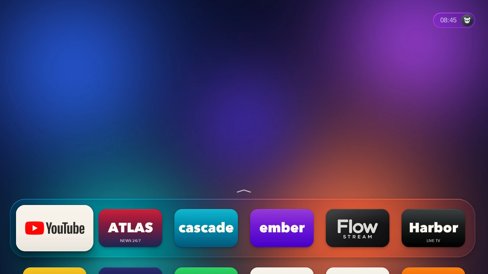
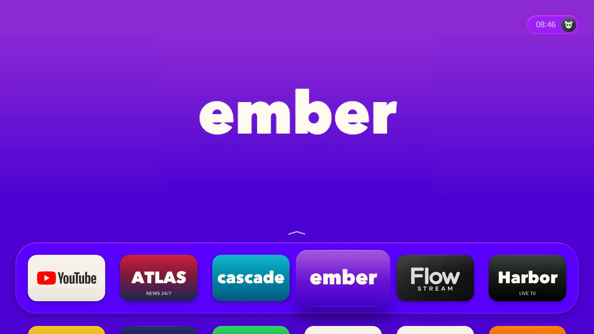
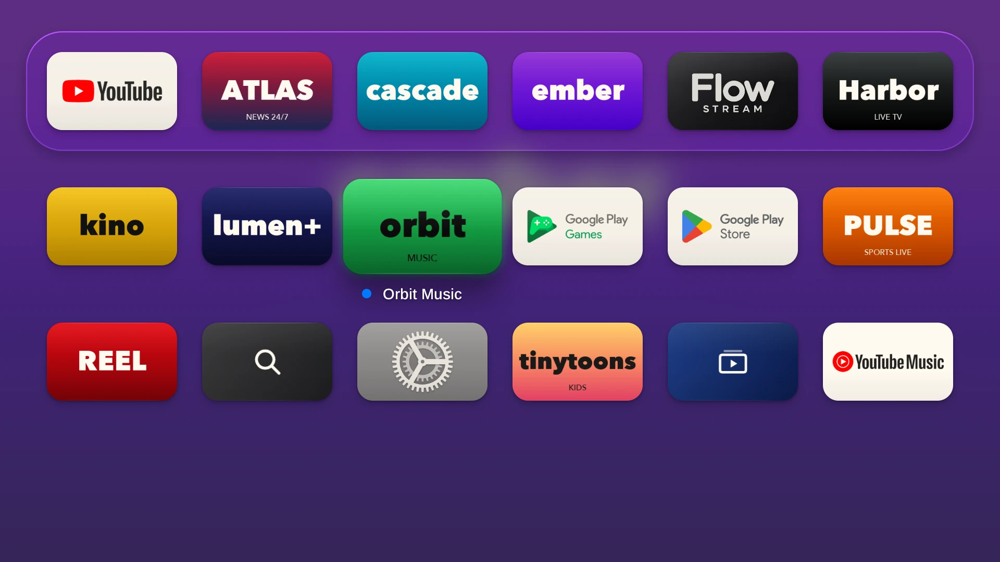
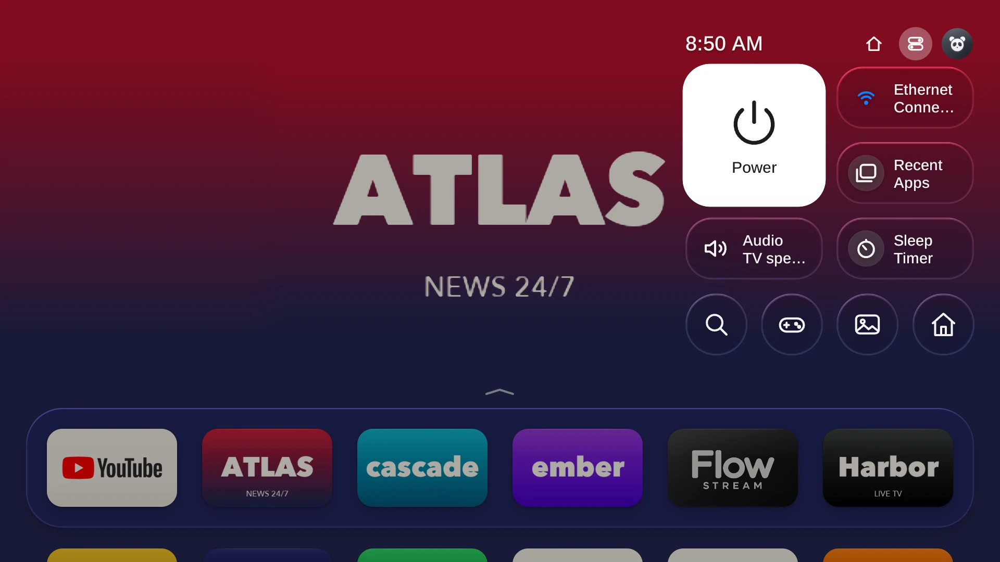
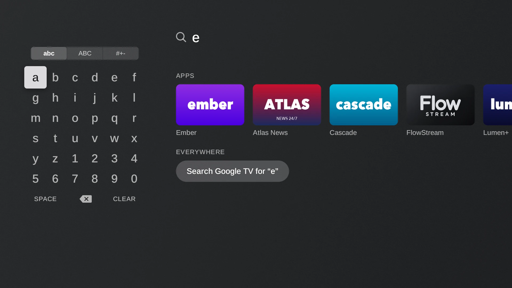
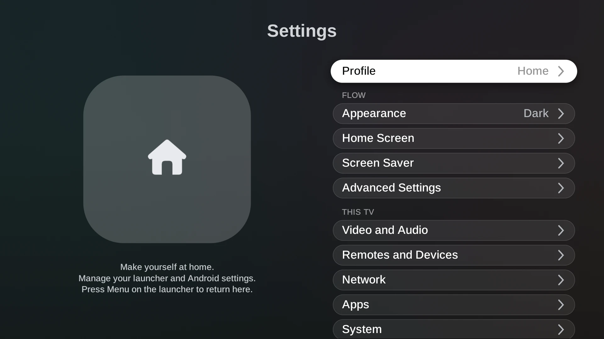
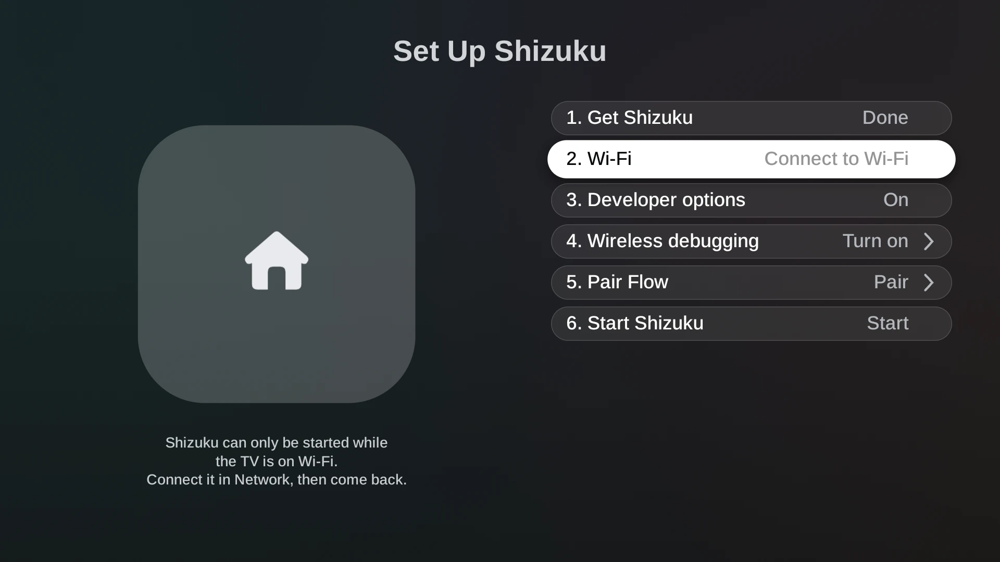
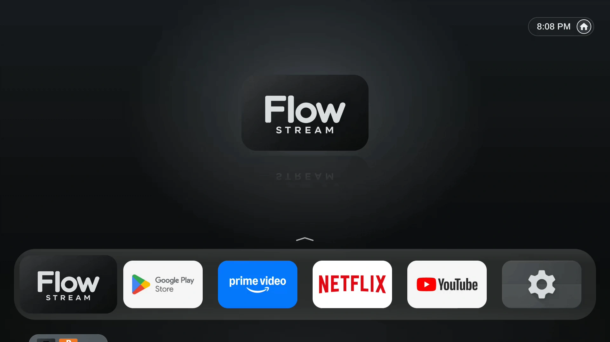
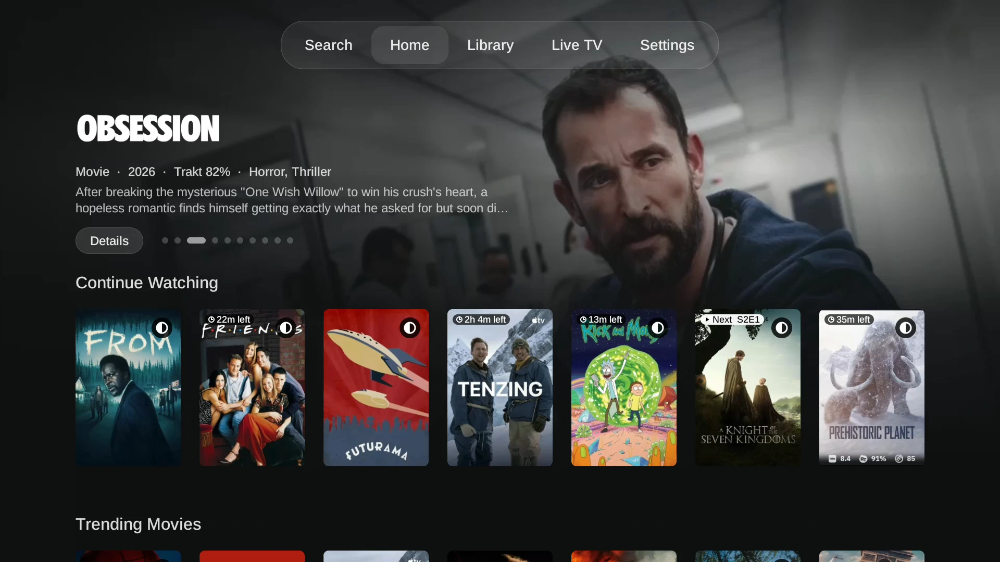
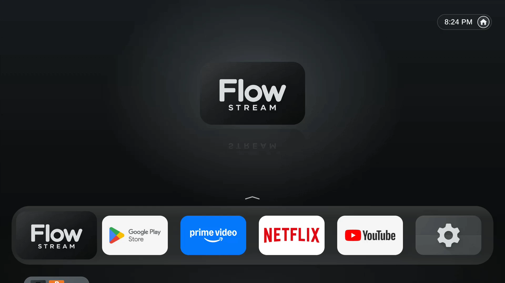

# Flow Launcher

**An Apple TV-style home screen for Android TV and Google TV.** Flow brings the tvOS look and feel to your TV: Liquid Glass, spring animations, a Top Shelf, Control Center, and an app switcher. It's a small native APK with no third-party libraries.

[](https://github.com/sghmire/flow-launcher-tv/releases/latest)



## Key Features

- **tvOS-like Home.** The tile size and spacing, focus glow, and how the grid scrolls and slides all follow tvOS. Your top row sits in a glass dock, with the Top Shelf above it.
- **Liquid Glass or Matte.** Each comes in Dark and Light. Liquid Glass is clear and bends what's behind it; Matte is softly frosted.
- **Top Shelf and content rows.** Continue Watching and picks from your apps, shown above the dock as large cards. Apps without content fill the screen with their own art when you focus them.
- **Up Next.** A full-screen view of everything you're watching, with rows of cards from each app, like Apple's TV app.
- **Video wallpapers.** Play Flow Video, Flow Photo, or your own photos and videos behind Home. Rotate can mix photos and videos and change them every 10 or 30 minutes, every hour, or every day.
- **Flow Keyboard.** A full-screen tvOS-style keyboard, used for search and in your apps, so you don't have to type with Gboard.
- **Recent apps.** Double-press Home to see your recent apps as large cards, then jump back in or swipe one away.
- **Control Center.** Hold Home in any app for quick controls while it keeps playing. Includes Power Off and Restart.
- **Search.** Find apps, shows from your apps, and hand anything else to Google TV's search.
- **Folders and Arrange Apps.** Create named folders, or sort Home by hand, by name, by most used, or by install date.
- **App animations.** Opening an app makes its tile grow to fill the screen. Pressing Home shrinks it back into its tile.
- **Screen saver, profile, and button mapping.** A Flow Clock screen saver with photos or videos, animal or monogram profile pictures, and remote buttons you can remap.
- **TV settings in Flow's style.** Wi‑Fi, resolution, Bluetooth, language, and more, laid out like tvOS Settings. Some of these need the optional [Advanced mode](#advanced-mode-shizuku).

## Screenshots

| | |
| :---: | :---: |
|  |  |
| **Home:** an app's art fills the screen when it has no Top Shelf content | **App grid:** move down from the dock to see all your apps |
|  |  |
| **Control Center:** hold Home for power, network, audio, and more | **Search with Flow Keyboard:** results update as you type |
|  |  |
| **Settings:** Flow's and the TV's settings in one tvOS-style list | **Set Up Shizuku:** each step and its status, in order |

## Visual Demos

### Open an app

The focused tile grows to fill the screen and lands right in the app.



### Close an app

Press Home and the app shrinks back into its tile. The app keeps running.



### Switch apps with Recents

Double-press Home to fan out your recent apps, browse them, and jump straight back in.



## Installation

Requires **Android TV or Google TV on Android 9 or newer**.

1. Download the `.apk` from the [latest release](https://github.com/sghmire/flow-launcher-tv/releases/latest).
2. Copy it to your TV (with a USB drive or an app like **Send Files to TV**). Open it in a file manager, allow **Install unknown apps** if asked, then choose **Install**.
3. Open **Flow**. A short welcome guides you through setup:
   - **Show what's on:** allow TV listings for the Top Shelf and Continue Watching.
   - **Make Home open Flow:** on Google TV, turn on **Flow** in **Settings › Accessibility** so the Home button opens Flow. If Flow is greyed out there, open Flow's **App info**, choose **Allow restricted settings**, and try again.
   - **Shizuku** (optional): see [Advanced mode](#advanced-mode-shizuku) below. Choose **Not now** to skip it. Flow works fine without it.

To update, install the newer APK over the old one. Your layout and settings are kept. Flow can also check for updates in **Settings › System › Software Update**.

Prefer ADB?

```sh
adb connect TV_IP:PORT
adb install -r Flow-vX.Y.Z.apk
adb shell cmd package set-home-activity com.gfs.flow/.HomeActivity
```

## Advanced Mode (Shizuku)

[Shizuku](https://shizuku.rikka.app/) is a free helper app. While it runs, Flow can change things a normal app isn't allowed to, without a computer:

- Switch Wi‑Fi networks, change the resolution, and change the language
- Set the screen saver, its start time, and the sleep timer
- Pair Bluetooth remotes and headphones without extra prompts
- Map a remote button to **Send a key**
- Turn off Google TV's own Home so the Home button always opens Flow

You only need to set it up once. After that, **Flow starts Shizuku by itself, even after the TV restarts.** No computer is needed.

**Before you start:** the TV must be on **Wi‑Fi**, because Shizuku starts through Wireless debugging. A TV on Ethernet only can't use it.

### Setup

Open **Flow Settings** (press **Menu** on Home) › **Advanced Settings** › **Shizuku** › **Set up**. The page lists each step with its status, and the step you need next is highlighted. Do them in order:


| Step | What to do |
| --- | --- |
| **1. Get Shizuku** | Select **Get**. Flow downloads Shizuku from its official GitHub and checks its signature. Google Play says Shizuku isn't compatible with TVs, so Flow gets it for you. If asked, allow Flow to **install unknown apps**, select **Get** again, and confirm the install. |
| **2. Wi‑Fi** | Should say **Connected**. If not, connect in **Settings › Network**. |
| **3. Developer options** | Select **Turn on** to open **About**. Select **Android TV OS build** 7 times until it says you're a developer, then press Back. |
| **4. Wireless debugging** | Select **Turn on**, then in **Developer options › Debugging**, turn on **Wireless debugging** and press Back. |
| **5. Pair Flow** | Flow reads the pairing code from the screen, so first turn on **Flow** in **Accessibility** if it isn't on yet. Then select **Pair**. In **Wireless debugging**, choose **Pair device with pairing code**. Flow reads the code and pairs by itself, with no typing. |
| **6. Start Shizuku** | Select **Start**. When Shizuku asks, choose **Allow**. |
| **7. Unlock Flow's settings** | Select **Unlock**. Every setting in Flow now works. |

When every step shows a check, you're done. Flow keeps Shizuku running across restarts as long as Wi‑Fi and Wireless debugging stay on.

<details>
<summary>Troubleshooting</summary>

- **"Shizuku didn't start":** make sure the TV is on Wi‑Fi and Wireless debugging is still on, then select **Start** again.
- **Flow is greyed out in Accessibility:** open Flow's **App info**, choose **Allow restricted settings**, and try again.
- **Shizuku shows Allow instead of Running:** select it and choose **Allow** when Shizuku asks.
- **Changing Wi‑Fi networks stops Shizuku:** Flow warns you before switching. Start it again from **Advanced Settings** afterwards.

</details>

<details>
<summary>Have a computer? Unlock without Shizuku</summary>

The screen saver, timers, and Home button settings only need two one-time permissions, which ADB can grant:

```sh
adb shell pm grant com.gfs.flow android.permission.WRITE_SECURE_SETTINGS
adb shell appops set com.gfs.flow WRITE_SETTINGS allow
```

Wi‑Fi, resolution, language, and Send a key still need Shizuku.

</details>

## Controls

| Button | Action |
| --- | --- |
| **D-pad** | Move between apps and Top Shelf cards |
| **OK** | Open the focused app, card, or folder |
| **Hold OK** | App options: move, folders, change icon, app info |
| **Back** | Close menus and folders; return to the dock |
| **Home** | Return to Flow |
| **Double Home** | Open Recents (where the TV allows it) |
| **Hold Home** in an app | Open Control Center |
| **Up in Recents** | Dismiss an app |
| **Menu** | Flow Settings |

## Source Code & Collaboration

Flow is closed source. Signed APKs are published on [GitHub Releases](https://github.com/sghmire/flow-launcher-tv/releases).

Want to collaborate? Android developers and designers are welcome, and access to the private source repository is available on request. Open a [GitHub Issue](https://github.com/sghmire/flow-launcher-tv/issues) or email **[contact@glideformstudio.com](mailto:contact@glideformstudio.com)**.

## Feature Requests

1. Requests are welcome, but they shouldn't change Flow's Apple TV-like look and experience.
2. Each request is checked so it won't noticeably slow the launcher down.
